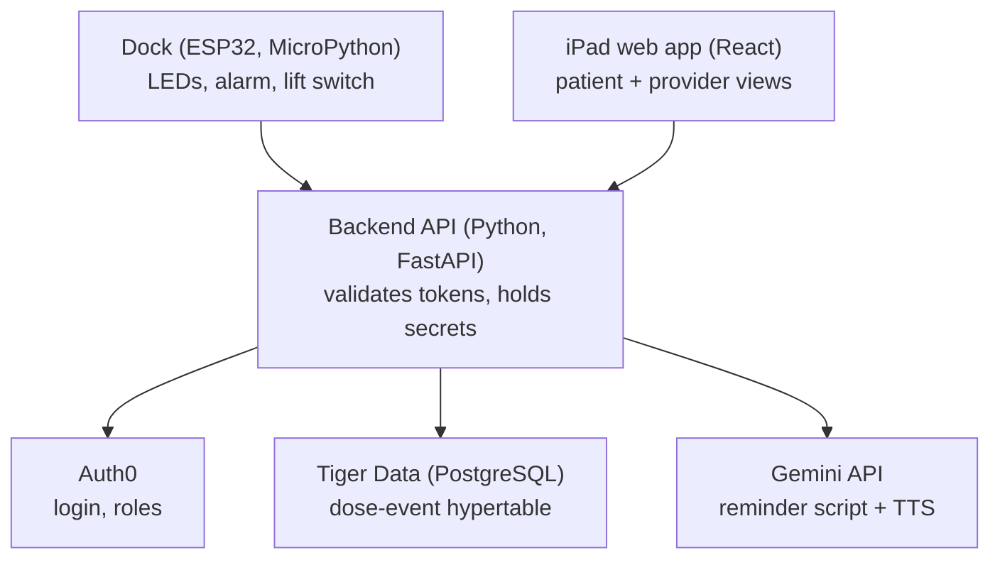

# Eye Spy 👁️

**An eye-drop adherence monitor for post-cataract patients.**
A smart bottle dock that knows when a dose is due and when the bottle was actually used, paired with a low-vision-friendly iPad web app for patients and their care providers.

Built in 36 hours at [SwampHacks XII](https://swamphacks-xii.devpost.com/) (University of Florida, October 2026).

> ⚠️ Hackathon prototype. Uses demo data only. Not a medical device and not HIPAA compliant.

---

## The problem

After cataract surgery, patients typically go home with several different eye drops (for example, an antibiotic, a steroid and an anti-inflammatory). The steroid usually tapers week by week, and different drops need a few minutes between them. For older patients with blurry post-surgery vision, that schedule is easy to get wrong, and missed or mistimed doses can affect recovery.

## What Eye Spy does

- **Reminds:** the dock lights up and sounds an alarm when a dose is due.
- **Detects:** a switch under the bottle's cup records when the bottle is lifted and returned, so a dose is logged automatically, with no extra button press.
- **Encourages:** the iPad speaks a short, personalized reminder in a warm, grandparent-style sense of humor, generated with the Gemini API. Humor can be set to full, mild or off.
- **Informs providers:** a provider view shows each patient's adherence over time (on time, late, too early, missed).
- **Protects data:** Auth0 login with role-based access, so providers only see their own patients and patients only see their own data.

## Architecture



- The **dock** polls the backend every 15 seconds to know when to alarm, and posts lift/return events.
- The **iPad app** is a single React web app, added to the iPad home screen so it opens full-screen. The view (patient or provider) depends on the user's Auth0 role.
- The **backend** sits between everything, so API keys and database credentials never ship inside the app or the device.

## Tech stack

| Layer | Technology |
| --- | --- |
| Hardware | ESP32 DevKit V1, LEDs, speaker / buzzer, push-button lift switch, 3D-printed enclosure |
| Firmware | MicroPython |
| App | React (JavaScript), HTML, CSS, built with Vite; runs on the iPad from Safari's "Add to Home Screen" |
| Backend | Python, FastAPI, psycopg |
| Auth | Auth0 (Universal Login, role-based access) |
| Database | Tiger Data (PostgreSQL + TimescaleDB): hypertables, continuous aggregates |
| AI | Gemini API (text generation + text-to-speech) |

## Accessibility decisions

Designed for older users with sensitive or blurry vision after surgery:

- Dark mode by default to reduce glare, with a high-contrast option (pure black, white and yellow)
- Large text that follows the iPad's text-size (Dynamic Type) setting
- One clear action per screen for patients: a big "Hear reminder" button
- Voice-first reminders that play automatically when a dose is due, so the patient doesn't need to read the screen
- Results always shown as a symbol and a word, not color alone (✓ On time, ✕ Missed)
- The dock has no small screen: just lights, sound and one large button

## Data model

- `patients`, `providers`, `medications`, `schedules` and `schedule_steps`: regular relational tables. Each taper step (4x a day, then 3x, 2x, 1x) is one `schedule_steps` row with its own dates and times.
- `dose_events`: a TimescaleDB **hypertable** with one row per scheduled dose, lift/return event and result
  - `scheduled_at`, `lifted_at`, `returned_at`, `flag` (`pending` | `on_time` | `late` | `early` | `missed` | `too_frequent`)
- `device_events`: a hypertable of the raw lift/return signals from the dock, kept for debugging
- A **continuous aggregate** (`daily_adherence`) of daily doses taken vs. scheduled per patient powers the provider dashboard.

## Dose rules

Each dose's flag is set by fixed rules in [backend/app/rules.py](backend/app/rules.py), never by the AI:

| Rule | Value |
| --- | --- |
| On time | bottle lifted within ±30 min of the scheduled time |
| Early / late | lifted up to 2 h before / up to 3 h after |
| Missed | not lifted within 3 h; until then the dock keeps alarming |
| Too frequent | a lift that matches no scheduled dose |
| Spacing | drops scheduled at the same time are staggered 5 min apart |

These values are product choices for the prototype and should be reviewed with a clinician.

## AI design and evals

Eye Spy separates **what is medically true** from **how it is said**:

1. **Rules decide.** The backend computes each dose's flag deterministically from the schedule and the dock's events.
2. **Templates state the instruction.** Medication name, dose and eye always come from the database through a fixed template, never from the model.
3. **Gemini adds the personality.** The model writes only the humorous opener and closer around the instruction, then Gemini TTS turns it into speech.
4. **Guardrails check the model.** A generated line is rejected if it contains a number, a medication name, medical wording, praise after a missed dose, or too many words. Safe built-in lines are used instead. With humor off, the model isn't called at all.

**Evals.** An eval set of 12 patient/schedule cases, each run at all three humor levels, checks every generated reminder for:

- the medication name and dose preserved exactly
- a tone that matches the flag (no "great job" after a missed dose)
- no added medical advice
- acceptable length and the requested humor level

| Check | Pass rate |
| --- | --- |
| Instruction preserved exactly | TODO |
| Tone matches flag | TODO |
| No medical advice | TODO |

Fill this table from a live run: `python evals/run_evals.py` with `GEMINI_API_KEY` set writes the results to `evals/results.md`.

## Hardware

| Part | Purpose |
| --- | --- |
| ESP32 DevKit V1 | WiFi microcontroller; talks to the backend |
| Red + green LEDs (220 Ω resistors) | Status: waiting / dose due |
| Speaker or buzzer | Alarm sound |
| Push button under the cup | Lift switch: detects the bottle being picked up and returned |
| Large push button | Silences the alarm for the current dose |
| 3D-printed enclosure | Box, fitted bottle cup with plunger, large button cap |

Wiring (full details in [hardware/README.md](hardware/README.md)):

| Part | ESP32 pin |
| --- | --- |
| Green LED | GPIO 25 |
| Red LED | GPIO 26 |
| Buzzer / speaker | GPIO 27 |
| Lift switch (to GND, pressed = bottle in cup) | GPIO 14 |
| Silence button (to GND) | GPIO 33 |

## Getting started

### Prerequisites

- Python 3.11+ and Node.js 18+
- An iPad with Safari (or any desktop browser for development)
- An ESP32 flashed with MicroPython 1.20+, plus `pip install esptool mpremote`
- Accounts: Auth0, Tiger Data (Tiger Cloud), Google AI Studio (Gemini API key)

### Environment variables

Backend (`backend/.env`, copied from [backend/.env.example](backend/.env.example)):

```
AUTH0_DOMAIN=
AUTH0_AUDIENCE=
AUTH0_ROLES_CLAIM=https://eyespy.app/roles
DATABASE_URL=
GEMINI_API_KEY=
DEVICE_TOKEN=
DEMO_PATIENT_SUB=
DEMO_PROVIDER_SUB=
ALLOWED_ORIGINS=http://localhost:5173
DEV_AUTH_BYPASS=false
```

App (`app/.env.local`, copied from [app/.env.example](app/.env.example)):

```
VITE_AUTH0_DOMAIN=
VITE_AUTH0_CLIENT_ID=
VITE_AUTH0_AUDIENCE=
VITE_API_BASE_URL=http://localhost:8000
```

Never commit real values. These files are listed in `.gitignore`.

### Auth0 setup (one time)

1. Create an **API** whose identifier is your `AUTH0_AUDIENCE`.
2. Create the roles `patient` and `provider` and assign them to your test users.
3. Add a **Login Action** that puts the roles into the access token:
   ```js
   exports.onExecutePostLogin = async (event, api) => {
     api.accessToken.setCustomClaim("https://eyespy.app/roles", event.authorization?.roles || []);
   };
   ```
4. Create a **Single Page Application**. Add your app URL to Allowed Callback URLs, Allowed Logout URLs and Allowed Web Origins, and turn on Refresh Token Rotation.
5. Put your test users' Auth0 user ids into `DEMO_PATIENT_SUB` and `DEMO_PROVIDER_SUB`.

### Run

1. **Backend and database:**
   ```bash
   cd backend
   python -m venv .venv
   .venv\Scripts\activate            # macOS/Linux: source .venv/bin/activate
   pip install -r requirements.txt
   python -m scripts.init_db         # tables, hypertables, continuous aggregate
   python -m scripts.seed --due-now  # demo provider, 2 patients, history, a dose due now
   uvicorn app.main:app --reload --host 0.0.0.0 --port 8000
   ```
   API docs: http://localhost:8000/docs
2. **App:**
   ```bash
   cd app
   npm install
   npm run dev
   ```
   Open the printed URL. On the iPad, open it in Safari and choose **Share → Add to Home Screen**.
3. **Dock:**
   ```bash
   cd firmware
   copy config_example.py config.py  # fill in WiFi, backend URL (laptop LAN IP), device token
   mpremote cp config.py :config.py
   mpremote cp main.py :main.py
   mpremote reset
   ```

> **iPad demos on a local network:** Auth0 login only works on HTTPS or `localhost`, not on `http://192.168.x.x`. For a local demo, set `VITE_DEV_BYPASS_SUB=auth0|demo-patient` in the app and `DEV_AUTH_BYPASS=true` in the backend. Otherwise host both the app and the backend on HTTPS. Never enable the bypass on a public server.

### Tests and evals

```bash
cd backend && python -m unittest discover -s tests -t .
python evals/run_evals.py           # from the repo root; uses Gemini if GEMINI_API_KEY is set
```

**Without the dock**, you can act as the dock with curl:

```bash
curl -H "X-Device-Token: <DEVICE_TOKEN>" http://localhost:8000/device/status
curl -X POST -H "X-Device-Token: <DEVICE_TOKEN>" -H "Content-Type: application/json" -d "{\"event\":\"lifted\"}" http://localhost:8000/device/events
```

## Repository structure

```
├── app/          # React iPad web app (patient + provider views)
├── backend/      # Python FastAPI server, database schema, seed script, tests
├── firmware/     # MicroPython code for the ESP32 dock
├── hardware/     # Wiring and enclosure notes (STL files: TODO)
├── evals/        # Reminder eval set and runner
└── BUILD_LOG.md  # What was built, why, and what has been verified
```

## Known limitations

- The dock has one cup, so it can't tell which bottle was lifted; a lift is matched to whichever dose is due.
- Any lift that matches no dose is logged as "too frequent", even if the bottle was just moved.
- Reminders only play while the app is open; the dock still alarms when it's closed.

See [BUILD_LOG.md](BUILD_LOG.md) for the full list.

## Future work

- **Weight sensing:** a load cell under the cup to estimate drops used per dose, flag over- or under-use, and predict when a bottle runs low
- One slot per medication for multi-drop regimens
- Caregiver view and notifications
- Push notifications so reminders reach the iPad when the app is closed

## Team

- TODO: name, role, GitHub
- TODO
- TODO
- TODO

## Acknowledgments

Built at SwampHacks XII with Auth0, Tiger Data and the Gemini API.
